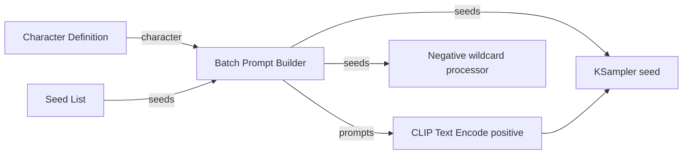

# comfyui-batch-builder

ComfyUI custom nodes for batch prompting: walk through a list of prompt lines and generate several seeded, wildcard-varied images per line, one queue run per line.

- **Before:** one prompt with wildcards and a seed list gives X variations in one run.
- **After:** Y prompt lines give X variations of each line, over Y runs, queued automatically.

## Nodes

All three are under `prompt/batch`.

### Character Definition

One character split into parts, each with an on/off switch:

| Part | Drop keyword |
| --- | --- |
| Base (name, series, skin, body type) | none |
| Hair | `nohair` |
| Head (hat, ahoge, ...) | `nohead` |
| Eyes | `noeyes` |
| Face (mask, mole, freckles, ...) | `noface` |
| Chest | `nochest` |
| Top | `notop` |
| Bottom | `nobottom` |
| Legs | `nolegs` |
| Feet | `nofeet` |

Outputs:

- `character`: structured string for Batch Prompt Builder.
- `preview`: enabled parts joined with `, `.

Trailing commas in the fields are not needed; parts are trimmed and joined automatically.

### Seed List

Makes `total` seeds from one master seed (`random`, `increment` or `decrement`, between `min_num` and `max_num`). The master seed randomizes after each queue by default.

- `seeds` is a list, so every node it feeds runs once per seed.
- `preview` shows the seeds as text.
- `total` is the seed count.

### Batch Prompt Builder

Builds the prompt for line `start_index`, makes one variant per seed, then queues the next line.

| Widget | Meaning |
| --- | --- |
| `start_index` | Line to generate, 1-based. Advances automatically. |
| `end_index` | Last line to generate, inclusive. `0` means the last line of the lists. |
| `batch` | Images per line (uses the first `batch` seeds). |
| `auto_advance` | Queue the next line after a successful run. |
| `prepend` / `append` | Fixed text around every prompt (style, artist, quality tags). |
| `booru` | One booru tag line per prompt. |
| `natural` | One natural-language line per prompt. |
| `character_booleans` | One keyword line per prompt, for example `nohead, noeyes, nobottom`. |

Each prompt is `prepend`, the booru line, the natural line, the character, and `append`, joined with spaces.

**Lines.** Booru and natural are read line by line together. Blank lines count, so line numbers stay stable. If both lists have content and their lengths differ, the shorter one is padded with empty lines and a warning is shown.

**Character keywords.** A part is included when it has text, its switch is on in Character Definition, and the current `character_booleans` line does not contain its drop keyword. Keywords are whole words, case-sensitive. An empty keyword line uses the switches alone. Unknown keywords are reported as warnings.

**Wildcards.** `{red hair|blonde hair|{short|long} black hair}` is resolved once per seed, so the same seed always gives the same prompt and matches the KSampler seed. Use `\{`, `\}` and `\|` for literal characters. Impact `__file__` wildcards are not supported.

Outputs:

- `prompts`: one resolved prompt per seed (list).
- `seeds`: the seeds actually used (list).
- `template`: the line before wildcard resolution.
- `status`: current line, variant count, dropped parts and warnings. Connect a text display node to watch progress.

## Wiring



- Connect KSampler and the negative wildcard processor to the **builder's** `seeds` output, not to the Seed List directly. That keeps prompt i, negative i and sampler seed i aligned, and stops the run cleanly after the last line.
- If a hires pass uses its own seeds, give it a second Seed List with the same `total`.
- Queue with **batch count 1**. The browser extension queues each next line itself.

Auto-advance runs in the ComfyUI browser tab: it listens for the finished run, sets `start_index` to the next line and queues again. It stops at `end_index`, at the end of the lists, on an error, or when you cancel. Prompts queued only through the API do not advance.

## Install

### Local ComfyUI

```bash
cd ComfyUI/custom_nodes
git clone https://github.com/ThedDryz/comfyui-batch-builder.git
```

Restart ComfyUI. No extra Python dependencies.

## Tests

```bash
python -m unittest discover -s tests
```
