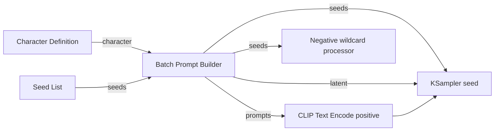

# comfyui-batch-builder

ComfyUI custom nodes for batch prompting: walk through a list of prompt lines and generate several seeded, wildcard-varied images per line, one queue run per line.

- **Before:** one prompt with wildcards and a seed list gives X variations in one run.
- **After:** Y prompt lines give X variations of each line, over Y runs, queued automatically.

## Nodes

All three are under `prompt/batch`.

### Character Definition

One character split into parts, each with an on/off switch:

| Part | Drop keyword |
| --- | --- |
| Base (name, series, skin, body type) | none |
| Hair | `nohair` |
| Head (hat, ahoge, ...) | `nohead` |
| Eyes | `noeyes` |
| Face (mask, mole, freckles, ...) | `noface` |
| Chest | `nochest` |
| Top | `notop` |
| Bottom | `nobottom` |
| Legs | `nolegs` |
| Feet | `nofeet` |

Outputs:

- `character`: structured string for Batch Prompt Builder.
- `preview`: enabled parts joined with `, `.

Trailing commas in the fields are not needed; parts are trimmed and joined automatically.

### Seed List

Makes `total` seeds from one master seed (`random`, `increment` or `decrement`, between `min_num` and `max_num`).

The master seed is chosen when the prompt is queued, like KSampler (Efficient), and ignores ComfyUI's "control before/after generate" setting:

- `seed` = `-1` picks a new master seed on every queue. The workflow saved with the images contains the real seed, not `-1`.
- **Randomize / Last Queued Seed** switches between `-1` and the newest queued seed.
- The row below shows the last four queued master seeds. Click one to pin it.
- Right-click the node for **Seed behavior**: `Randomize`, `Increment` or `Decrement` the master seed from the last one while `seed` is `-1`.

Outputs:

- `seeds` is a list, so every node it feeds runs once per seed.
- `preview` shows the seeds as text.
- `total` is the seed count.

### Batch Prompt Builder

Builds the prompt for line `start_index`, makes one variant per seed, then queues the next line.

Text fields are labeled and can be rolled up: click a label to roll or unroll it, and drag a field's bottom edge to resize it on its own. A rolled field shows a preview of its first line. Character Definition fields work the same way, with each part's on/off switch on its label row. These fields are typed in on the node; they do not accept a STRING link from another node.

The grey placeholder names the data type: `text` is one block of text, `multiline text` is one string per prompt line, and `multiline int` is one integer per prompt line.

| Widget | Meaning |
| --- | --- |
| `start_index` | Line to generate, 1-based. Advances automatically. |
| `end_index` | Last line to generate, inclusive. `0` means the last line of the lists. |
| `batch` | Images per line. Uses the first `batch` seeds; if there are fewer seeds than `batch`, they repeat in order (4 seeds, batch 6: 1 2 3 4 1 2). |
| `auto_advance` | Queue the next line after a successful run. |
| `prepend` / `append` | Fixed text around every prompt (style, artist, quality tags). |
| `booru` | One booru tag line per prompt. |
| `natural` | One natural-language line per prompt. |
| `character_booleans` | One keyword line per prompt, for example `nohead, noeyes, nobottom`. |
| Latent size `W` / `H` | One width and one height per prompt line, side by side under one header. |
| `vary_wildcards` | Off by default. When on, a seed that repeats in the batch gets a new wildcard roll each time (see Wildcards). |

Each prompt is `prepend`, the booru line, the natural line, the character, and `append`, joined with spaces.

**Lines.** Booru and natural are read line by line together. Blank lines count, so line numbers stay stable. If both lists have content and their lengths differ, the shorter one is padded with empty lines and a warning is shown.

**Character keywords.** A part is included when it has text, its switch is on in Character Definition, and the current `character_booleans` line does not contain its drop keyword. Keywords are whole words, case-sensitive. An empty keyword line uses the switches alone. Unknown keywords are reported as warnings.

**Latent size.** Each prompt line gets its own width and height, read from the same line number as the prompt. All `batch` images of that line share the size. A list shorter than the prompts reuses its last value; an empty list or a line that is not a positive integer uses 1024. Values that are not multiples of 8 are rounded down to one (minimum 64). Each of these cases shows a warning in `status`.

**Wildcards.** `{red hair|blonde hair|{short|long} black hair}` is resolved once per seed, so the same seed always gives the same prompt and matches the KSampler seed. Use `\{`, `\}` and `\|` for literal characters. Impact `__file__` wildcards are not supported.

To test wildcard variations on a single sampler seed, set Seed List `total` to 1, `batch` to 4 and turn on `vary_wildcards`. KSampler gets the same seed four times; the first prompt is the one that seed always gives, and the other three use different, repeatable wildcard rolls. Distinct seeds are unaffected. Wildcards resolved by other nodes from the `seeds` output (such as a negative wildcard processor) still see only the sampler seed and do not vary.

Outputs:

- `prompts`: one resolved prompt per seed (list).
- `seeds`: the seeds actually used (list).
- `template`: the line before wildcard resolution.
- `status`: current line, variant count, latent size, dropped parts and warnings. Connect a text display node to watch progress.
- `latent`: an empty latent (batch size 1) at the line's width and height. Connect it to KSampler `latent_image` in place of Empty Latent Image.

## Wiring



- Connect KSampler and the negative wildcard processor to the **builder's** `seeds` output, not to the Seed List directly. That keeps prompt i, negative i and sampler seed i aligned, and stops the run cleanly after the last line.
- If a hires pass uses its own seeds, give it a second Seed List with the same `total`.
- Queue with **batch count 1**. The browser extension queues each next line itself.

Auto-advance runs in the ComfyUI browser tab: it listens for the finished run, sets `start_index` to the next line and queues again. It stops at `end_index`, at the end of the lists, on an error, or when you cancel. Prompts queued only through the API do not advance.

## Install

### Local ComfyUI

```bash
cd ComfyUI/custom_nodes
git clone https://github.com/ThedDryz/comfyui-batch-builder.git
```

Restart ComfyUI. No extra Python dependencies.

## Tests

```bash
python -m unittest discover -s tests
```
